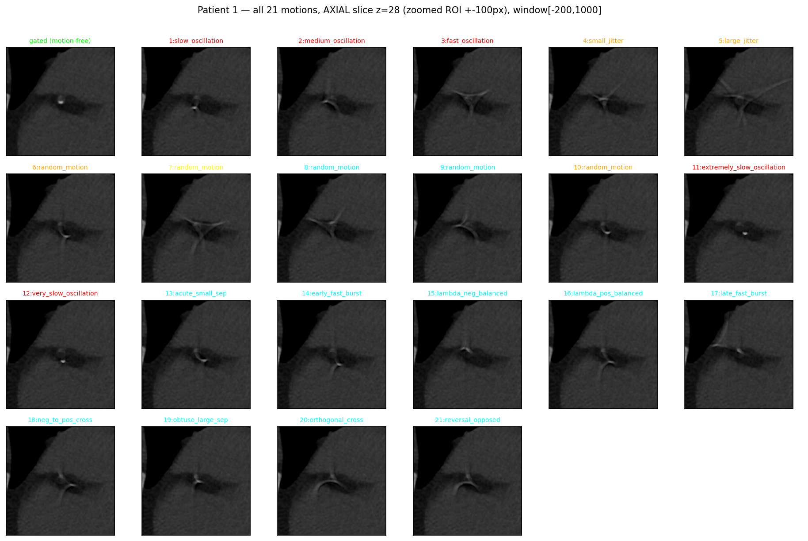

# Calcium-only coronary motion simulation

Generates motion-corrupted cardiac-CT reconstructions from a gated (motion-free)
volume and its per-artery calcium mask, by displacing **only the coronary-calcium
deposits** across projection views and re-reconstructing. Surrounding anatomy is
held fixed without any global transformation or warping.



*All motion profile simulations for one patient (axial slice zoomed on a coronary-calcium
ROI, window HU [-200, 1000]). Top-left is the gated motion-free scan; each other
panel is the same slice after a different simulated motion. Note the image was zoomed in to 
highlight the calcium deposits, which are the only structures that move in this simulation.*

## Files

| File | Purpose |
|---|---|
| `simulate_motion_calcium_only.py` | Unified script for simulating the different motion profiles given motion_config.json |
| `run_batch_all_patients.py` | Resumable batch driver: generate all motion profiles for every patient |
| `calcium_simulator.py` | `CalciumMotionSimulator`: deposit detection, inpainting, per-view displacement |
| `utils.py` | `load_nifti` and helpers |
| `motion_config.json` | Example motion profile configurations |

### `motion_config.json` schema

Keyed by **motion index**; each entry has a `name`, a `type`, and that type's
parameters:

```jsonc
{
  "1": {                                  // oscillation / jitter
    "name": "slow_oscillation",
    "type": "oscillation",                // "oscillation" | "jitter" | "translation" | "piecewise" | "random"
    "cycles_range": [0.2, 0.3],           // cycles per scan (sampled uniformly)
    "disp_range":   [10, 14]              // displacement magnitude, mm
  },
  "6": { "name": "random_motion", "type": "random",
         "cycles_range": [0.2, 1.5], "disp_range": [6, 15] },  // resolves to 1 of 4 types
  "13": {                                 // piecewise
    "name": "acute_small_sep", "type": "piecewise", "jitter_px": 0.01,
    "piecewise_theta1": {"type": "range", "min": 30.0, "max": 45.0},
    "piecewise_v1": {"type": "range", "min": 0.03, "max": 0.06},
    "piecewise_t_star": {"type": "range", "min": 50, "max": 70},
    "piecewise_dwell": {"type": "choice", "values": [0, 2]}
    // ...theta2 / v2 likewise
  }
  // ...
}
```

Piecewise param fields accept `{"type":"fixed","value":..}`, `{"type":"range","min":..,"max":..}`,
or `{"type":"choice","values":[..]}`. In the dataset the piecewise entries are
numbered **alphabetically** by name (acute_small_sep=13 … reversal_opposed=21).

## Usage

```bash
# All 21 motions for one patient
python simulate_motion_calcium_only.py \
    --volume Gated_niftii/2.nii \
    --mask   mask_per_artery/mask_2.nii.gz \
    --output motion_out/2 \
    --angles 180 --seed 42

# You can also simulate a single motion by name as specified in motion_config.json:
python simulate_motion_calcium_only.py ... --only fast_oscillation
python simulate_motion_calcium_only.py ... --only lambda_pos_balanced
```

Outputs: `motion_out/<patient>/reconstructions/recon_<name>_<index>.nii.gz`